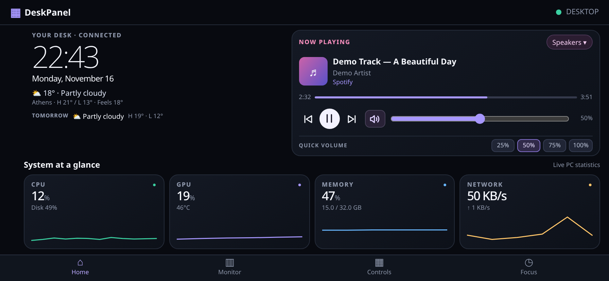
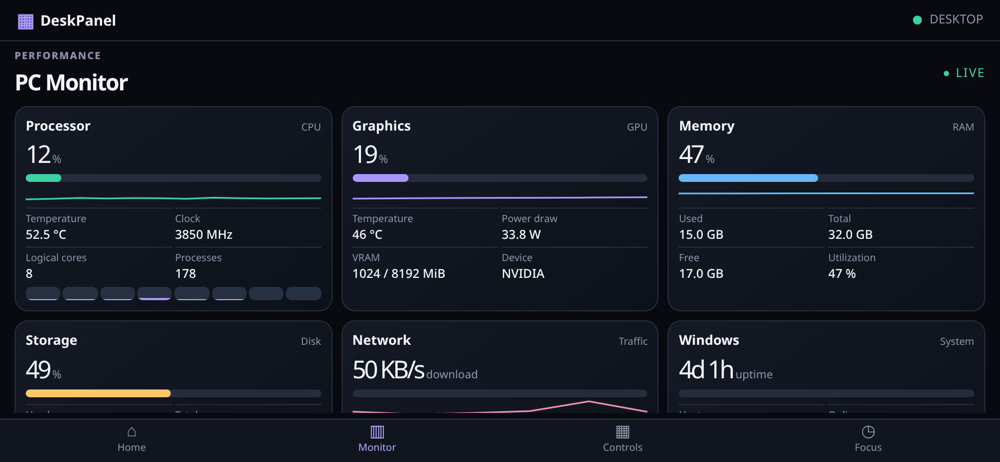
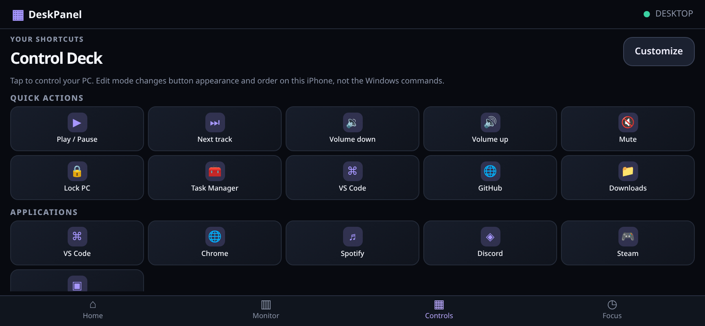
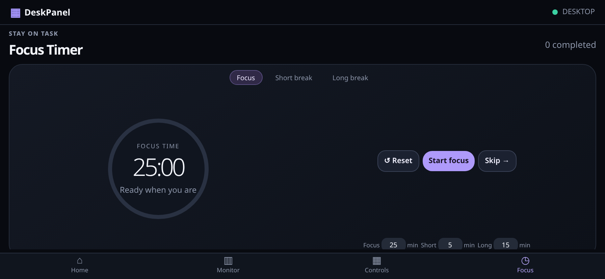

# DeskPanel

**Turn an iPhone into a compact companion dashboard for a Windows PC.**

DeskPanel runs a small Python server **on your own Windows PC** and displays a touch-friendly dashboard in Safari on the same trusted Wi-Fi network. No iOS app installation or cloud account is required. The Home page is designed for **iPhone 11 landscape (896 × 414 CSS pixels)** with no vertical scrolling. **Device tested by the project creator: iPhone 11 running iOS 26.6.**

> **Security:** Intended for a trusted home LAN only. **Do not expose the port to the internet** or use on an untrusted/shared Wi-Fi network. Traffic uses plain HTTP; the access key in the URL is a secret. See [SECURITY.md](SECURITY.md).

## Screenshots

*Screenshots use simulated PC and weather data. No personal computer names, access keys, or private URLs are shown.*

### Home — weather, media and PC performance



### Monitor — CPU, GPU, memory, storage and network



### Controls — shortcuts and app launchers



### Focus — Pomodoro timer



## Features

- **Home:** clock, current weather, tomorrow's forecast, album art, track information, media application name, track progress, quick CPU/GPU/RAM/network readouts.
- **Media:** previous, play/pause, next, a visible mute button, master volume slider, **25 / 50 / 75 / 100% presets**, and a selector for available Windows audio outputs.
- **Monitor:** per-core CPU use, optional CPU temperature, NVIDIA GPU usage/temperature/VRAM/power, RAM, disk I/O, network traffic, uptime and process count.
- **Controls:** configured Windows shortcuts and app launchers. Rearrange, hide, or recolor buttons on the iPhone; actual commands remain configured on the Windows PC.
- **Focus:** configurable Pomodoro timer, short/long breaks and completed-session count.
- **Compact display:** iPhone landscape Home fits without scrolling; data-dense Monitor/Controls pages may scroll internally.
- **No tap-to-wake overlay:** the idle dark screen was removed. The subtle one-pixel clock shift remains to reduce static positioning; it is not guaranteed burn-in protection.

## Install (Windows + iPhone)

1. Install **Python 3.10+** on Windows and check **Add Python to PATH**.
2. Download or clone this repository into its own folder.
3. Double-click **`start.bat`**. It installs `psutil` and attempts optional audio/media packages, then starts the local server. **Leave the terminal window running.**
4. If Windows Firewall asks, allow access on **Private networks only**; do not allow Public networks.
5. On an iPhone connected to the **same trusted Wi-Fi**, open the URL printed by the server. It looks like `http://192.168.x.x:8765/?k=YOUR_PRIVATE_KEY`.
6. In Safari: **Share → Add to Home Screen**. Rotate the phone to landscape.

At first start, the server copies `config.example.json` to a private **`config.json`** and generates a random access key. **Do not commit `config.json` or share your full dashboard URL.** If this new folder is placed alongside a previous `DeskPanel-v6` (or v5/v4/v3/v2) folder, the server attempts to reuse that existing strong key so your saved iPhone URL can keep working (assuming the PC IP and port are unchanged). The old folder is not modified.

Only run one copy on the configured port (default `8765`). For a consistent link, use a DHCP reservation for your PC in your router.

## Customization

Edit **`config.json`** on the Windows PC, then restart DeskPanel. Change weather coordinates, shortcuts, apps and port. The public **`config.example.json`** contains safe sample settings but no key.

Supported action types:

| Type | Example | Notes |
| --- | --- | --- |
| `media` | `"value": "play_pause"` | Media keys handled by Windows |
| `open` | `"value": "%USERPROFILE%\\Downloads"` | URLs, files, folders, URL protocols |
| `lock` | `"type": "lock"` | Lock Windows workstation |
| `exec` | `"value": "notepad.exe", "args": []` | Recommended: launches an explicit program without shell |
| `command` | `"value": "some command"` | Legacy shell action; keep values trusted and avoid using it for new shortcuts |

The iPhone **Controls → Customize** panel changes icons, accent colors, order, and visibility locally in Safari. It **does not allow editing executable Windows commands** through the web interface.

## Optional integrations

- **Windows media metadata/artwork:** Windows WinRT packages attempted by `start.bat`. Media keys still work without metadata.
- **Volume and audio output switching:** [`pycaw`](https://github.com/AndreMiras/pycaw) and Windows COM. Switching uses an undocumented Windows endpoint API and may not work on all Windows versions/devices.
- **GPU readings:** NVIDIA `nvidia-smi` tool / driver required. Other GPU vendors may show unavailable.
- **CPU temperature:** Requires a compatible sensor source. On Windows, try LibreHardwareMonitor and optional `wmi`; not all systems expose CPU temperature.
- **Weather:** Uses Open-Meteo. Internet access from the Windows PC is required for weather forecasts.

## Test

Run:

```bash
python -m unittest discover -s tests -v
```

Tests cover local HTTP authorization, invalid indexes, security headers, public-config handling, and frontend elements. JavaScript syntax can be checked with `node --check static/app.js`. The repository previews have also been rendered in Chromium at 896 × 414 with **simulated data**, but **Windows-only media/output actions have not been verified in this environment**. The project creator has also used DeskPanel on a physical **iPhone 11 (iOS 26.6)**; this does not guarantee every feature or future iOS version.

## Project layout

```text
DeskPanel/
├── README.md
├── SECURITY.md
├── .gitignore
├── config.example.json    # Public sample — never a real key
├── index.html
├── server.py
├── start.bat
├── requirements.txt
├── static/
│   ├── app.js
│   └── style.css
├── screenshots/
│   ├── home.png
│   ├── monitor.png
│   ├── controls.png
│   └── focus.png
└── tests/
    ├── test_server.py
    ├── test_media_ui.py
    └── test_release.py
```

## Privacy and security

- No public hosting or external relay is needed for the dashboard. The local server **must be reachable from the iPhone on your trusted LAN**.
- Never publish your generated `config.json`, full `?k=` URL, IP/host details from your private installation, or recordings of sensitive controls.
- The app currently uses **HTTP, not HTTPS**, and a URL query-string bearer key. Use only on networks you trust and do not forward the port.
- Do **not** run DeskPanel as Administrator.
- See [SECURITY.md](SECURITY.md) for the security limitations and disclosure guidance.

## Status

Community-ready **preview**: the source and simulated dashboard are tested, and the project creator has used DeskPanel on an **iPhone 11 (iOS 26.6)**. Windows audio/device switching and comprehensive real-device regression testing remain outstanding. Feedback and contributions are welcome once published.
